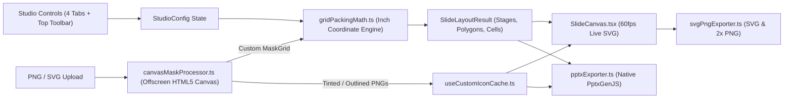

# WaffleFlow Studio


**WaffleFlow Studio** is a zero-backend, deterministic **Isotype Waffle & Multi-Stage Funnel Generator** built with React, TypeScript, Tailwind CSS, HTML5 Offscreen Canvas processing, and `pptxgenjs`. Every pixel calculation, PNG alpha/silhouette sampling operation, SVG preview, and native PowerPoint `.pptx` export executes locally in the browser.

---

## Core Capabilities

- **Level 1 — Individual Unit Icon Control**:
  - 7 crisp vector presets (`Square`, `Rounded Square`, `Circle`, `Diamond`, `Hexagon`, `Person Silhouette`, `Star`) plus custom `.png` / `.svg` upload.
  - `Filled` vs `Outline` render modes. For uploaded PNGs, an offscreen HTML5 `<canvas>` runs alpha-channel tinting in Filled mode and 8-neighbor boundary edge detection in Outline mode.
  - Adjustable icon sizing (`8–28 px`) and gap spacing (`0–12 px`).
- **Level 2 — Macro Container Shape Control**:
  - `Funnel Trapezoid` (entry matches prior stage exit %, tapering cleanly to current stage %).
  - `Square / Rectangle Grid`, `Parliament / Arc-Dot Chart` (concentric arc rows with per-stage arc length `30°–360°` and rotation `-180°–180°` in the Stages tab), `Triangle / Pyramid`, and `Custom Silhouette PNG Mask` (128×128 pixel luminance/alpha occupancy sampler + built-in sample masks).
  - `Bottom-to-Top`, `Top-to-Bottom`, and `Left-to-Right` fill ordering.
- **Level 3 — Multi-Stage Funnel & Per-Stage Density**:
  - `1 to 5` stages pre-loaded with a realistic 4-stage B2B SaaS pipeline.
  - Direct editing of either stage absolute value or `% decrease` (step drop-off) from the preceding stage.
  - Independent per-stage icon density (`10–400` icons per stage) with 1-click uniform sync.
  - `Trapezoid`, `Constant Slope` (linear taper from initial to final stage), and `Uniform` sizing modes, optional ghost drop-off units, and transition connectors with optional transparent outlines.
  - **Multi-Color Container Segments**: Per-stage toggle to split active unit icons across 2–6 custom color segments with editable labels, hex colors, proportional share weights (Hamilton rounding), Equal Split action, and automatic bottom legend in SVG, PNG, and native PPTX exports.
- **Executive Styling & Native PPTX Export**:
  - 6 curated corporate palettes (*Consulting Blues*, *Corporate Emerald*, *Terracotta & Slate*, *Monochrome Executive*, *Vibrant Product*, *Colorblind-Safe Viridis*) plus per-stage hex pickers.
  - `16:9 Widescreen` (`13.33" × 7.5"`) and `4:3 Standard` (`10" × 7.5"`) slides in `Horizontal` or `Vertical` flow.
  - **Download Native PPTX** exports editable PowerPoint shapes (`rect`, `roundRect`, `ellipse`, `diamond`, `hexagon`, `star5`, `custGeom` polygons), editable `Arial` text boxes, and Canvas-tinted PNG unit assets.
  - **Export SVG** & **Export PNG** (2x high-DPI rasterization).

---

## Architecture Overview



---

## Local Development & Testing

```bash
# Install dependencies
npm install

# Start development server on port 3000
npm run dev

# Run TypeScript typecheck
npm run lint

# Run Vitest unit & integration test suite
npm test

# Build production bundle
npm run build
```

---

## GitHub Pages Deployment

Push to `main` to trigger `.github/workflows/deploy.yml`, which runs `npm run lint`, `npm test`, `npm run build` (using the repository-matched `base` path in `vite.config.ts`), and deploys `./dist` to GitHub Pages.
